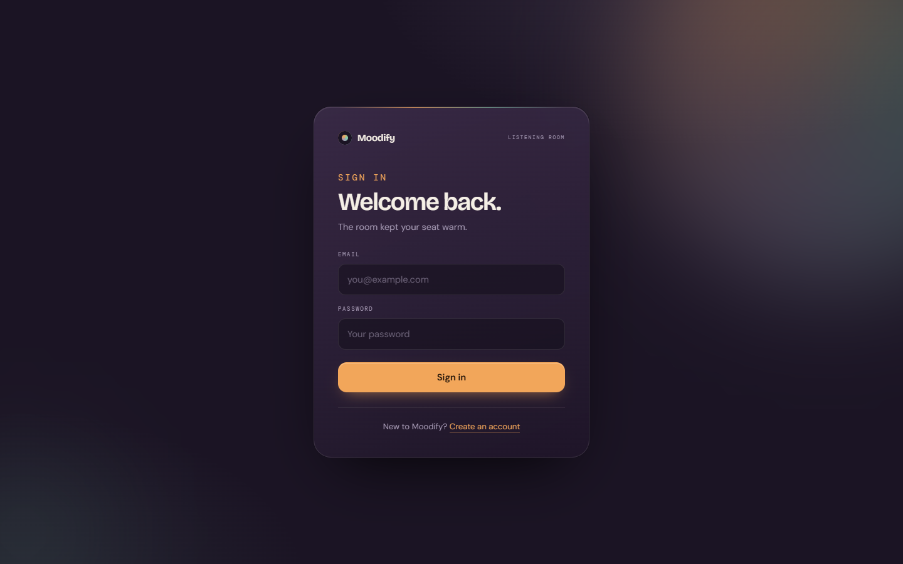
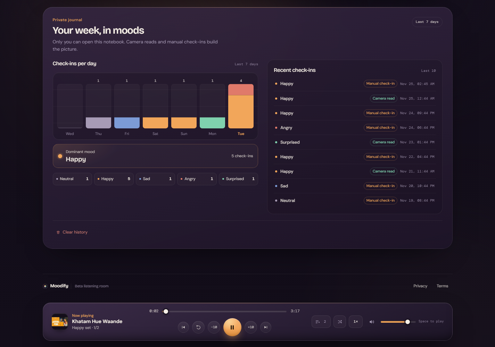

# MoodMusic

> A listening room that reads the room, then tunes the queue.

[](https://moodmusic.furqankhan.dev)
[](https://furqankhan.dev)
[](LICENSE)

MoodMusic is a privacy-first mood listening room. It reads an expression on-device with MediaPipe, or takes a manual check-in, then builds a queue for one of five moods and records the check-in in a private weekly journal. It is for anyone who wants music selection to start from how they feel rather than a genre. Part of [Furqan Khan's portfolio](https://furqankhan.dev).

**Live:** https://moodmusic.furqankhan.dev · **Source:** https://github.com/fk219/mood-music · **Case study:** https://furqankhan.dev





## What it is

The room has two ways in. The mood lens uses the camera and MediaPipe Face Landmarker entirely in the browser. The manual check-in offers all five moods without a camera. Either path selects tracks from the room's shared catalog, starts playback, updates the queue and changes the mood ring.

Every check-in belongs to the signed-in listener. The journal shows the last seven days, the dominant mood and the ten most recent entries. A protected Studio lets a signed-in listener upload tagged MP3s; `STUDIO_EMAIL` can reserve it for the catalog owner. The account settings page exports the journal or deletes the account. This is not a streaming-service integration: the room plays the catalog stored for it.

## The signature idea

Most music apps start with a genre. MoodMusic starts with a reading. The camera produces a small set of facial blendshapes, `classifyExpression` maps them to a mood, and the same `selectMood` path handles both camera and manual input. That path fetches `/api/song?mood=<mood>`, orders the queue, starts the player and updates the room theme. Camera reads are written to the journal through `/api/mood` at most once every 30 seconds; manual picks record immediately.

No video frame leaves the device. The MediaPipe WASM runtime and face model are downloaded from a CDN, but inference happens in the browser. The journal is stored per user in MongoDB and is only returned to that signed-in user. When a mood has no tracks, the API falls back to the neutral set rather than leaving the room empty.

The camera classifier currently produces Neutral, Happy, Sad or Surprised. Angry is available through the manual picker, alongside the other four moods.

## What works

**Mood lens**

- On-device face detection with MediaPipe Tasks Vision `FaceLandmarker`, one face and expression blendshapes, using the MediaPipe GPU delegate.
- Explicit Detect mood and Stop reading controls, with camera permission and camera-error guidance plus a retry action.
- Camera reads change the room only when the detected mood changes, and are recorded at most once every 30 seconds on both the client and the server.
- A local mood trail keeps the last five reads and collapses an identical mood repeated within 15 seconds.
- The camera is optional; the room never requires it.

**Manual check-in**

- All five moods are available without a camera: neutral, happy, sad, angry and surprised.
- A pick uses the same selection path as a camera read: fetch tracks, build the queue, autoplay and update the room.
- Manual check-ins are saved to the journal immediately and marked as `manual`.

**Library, queue and player**

- The Library panel groups the real catalog by mood with cover art, track counts and play actions.
- Playing a track sets the queue to that mood's tracks; previous and next wrap through the queue.
- Shuffle reorders the current queue, auto-advance keeps the room playing, and the Up next panel shows what follows.
- The current track is marked in the library and in the fixed player bar.
- Play, pause, seek, restart, back 10 seconds, forward 10 seconds, volume, mute and playback speeds of 0.75x, 1x, 1.25x and 1.5x. Space toggles playback when focus is outside a control.

**Mood journal**

- Seven-day UTC window with stacked bars by mood, per-day totals, five mood counts, dominant mood and the last ten check-ins.
- Each entry records its source (`camera` or `manual`) and timestamp.
- Clear history removes only the signed-in user's entries.
- A mood with no tracks safely falls back to the neutral set, and the player says so.

**Owner Studio**

- Protected `/studio` route reachable from the room header.
- MP3 picker, mood selector, upload progress, success and error states, and a result card.
- Validation: MP3 only, 15 MB maximum, a valid mood, an ID3 title and embedded cover art.
- Uploads require a signed-in session. Set `STUDIO_EMAIL` to reserve the Studio for one owner account.

**Accounts and room**

- Register, log in, log out, and protected room, Studio and Settings routes.
- One-click demo room: the sign-in page calls `POST /api/auth/demo`, which finds or creates the shared demo listener and opens a normal session. No password is exposed to visitors.
- JWT in an `httpOnly`, `SameSite=Lax`, `Secure` cookie in production; bcryptjs password hashing; logged-out tokens are blacklisted in MongoDB with a TTL index.
- A `tokenVersion` claim revokes every session when the password changes.
- Settings shows the listener card, exports account and journal JSON, changes the password and deletes the account. The shared catalog survives account deletion; the demo account is protected.
- Helmet security headers, CORS origin checks and per-IP limits on auth writes, account changes, mood writes and uploads.

## Tech stack in detail

| Layer | Technology | What it does here |
|---|---|---|
| Web client | React 19, Vite 6, React Router 7 | Listening room, auth, Studio, settings and legal pages |
| Styling | Sass | Mood themes, record-shelf layout, player bar and responsive panels |
| Face detection | `@mediapipe/tasks-vision` 0.10.35 | Browser FaceLandmarker with blendshape output; no frames uploaded |
| API | Node.js 22, Express 5 | REST API under `/api`, plus `/` and `/health` |
| Database | MongoDB, Mongoose 9 | Users, songs, mood entries and the logout blacklist |
| Auth | `jsonwebtoken`, `bcryptjs` | Cookie sessions, hashed passwords, token versioning |
| Uploads | `multer`, `node-id3`, `@imagekit/nodejs` | MP3 and tag validation, cover extraction, ImageKit storage |
| Hardening | `helmet`, `express-rate-limit`, CORS allowlist | Headers, per-IP limits, origin checks |
| Hosting | Vercel, Render, MongoDB Atlas | Static web app, API service and managed database |
| Analytics | `@vercel/analytics` | Page analytics on the web app |

## Architecture

The browser loads the React SPA from Vercel. `frontend/vercel.json` rewrites `/api/*` to the Render API and all other paths to `index.html`, including `/studio` and `/settings`. The API handles auth, song and mood routes, stores users, tracks, mood entries and revoked tokens in MongoDB, and sends audio and cover art to ImageKit.

Camera work stays local: the browser loads the MediaPipe runtime and model, opens the camera with `getUserMedia`, and runs `detectForVideo` in a `requestAnimationFrame` loop. Only the resulting mood and its source are sent to the API. Journal reads aggregate seven UTC days and return the ten most recent entries.

```
Camera --> MediaPipe FaceLandmarker --> blendshapes
                                            |
                                 classify expression
                                            |
Manual check-in ----------------------------+
                                            v
                          GET /api/song?mood=<mood>
                                            |
                          queue + player + mood ring
                                            |
                          POST /api/mood (camera throttled)
                                            v
                          GET /api/mood/summary --> journal
```

```
backend/
  server.js
  src/app.js                     Express app, Helmet, CORS, error handling
  config/database.js             Mongoose connection
  routes/                        auth.routes.js, song.routes.js, mood.routes.js
  controllers/                   auth, song upload/library, mood journal
  models/                        User, Song, MoodEntry, Blacklist
  middleware/                    auth, upload, rate limits, Studio owner gate
  services/storage.service.js    ImageKit storage
  utils/mood.js                  Shared mood normalization
  test/api.test.js
frontend/
  src/app.routes.jsx             Room, Studio, Settings, auth and legal routes
  src/features/
    Expression/                  Camera, face landmarks, mood lens
    home/                        Player, queue, manual check-in, library, journal
    studio/                      Owner upload page
    settings/                    Account summary, password, export, delete
    auth/                        Auth context, pages, guards
    legal/                       Privacy and terms
    shared/                      API client, header, footer, icons
docs/
  preview.png journal.png
frontend/vercel.json             SPA fallback and /api proxy
.github/workflows/ci.yml         API tests, syntax check, web lint and build
```

## Run it locally

Prerequisites: Node.js 22 (see `.nvmrc`), npm, a MongoDB connection string and an ImageKit private key. The API tests use an in-memory MongoDB.

```bash
# API
cd backend
npm install
cp .env.example .env         # fill MONGO_URI, JWT_SECRET and IMAGEKIT_PRIVATE_KEY
npm run dev                  # http://localhost:3000

# Web
cd ../frontend
npm install
cp .env.example .env.local   # optional: point at a local API
npm run dev                  # http://localhost:5173
```

The Vite dev server proxies `/api` to the deployed Render API by default. To use the local API instead:

```bash
# frontend/.env.local
VITE_API_URL=http://localhost:3000
```

On PowerShell, replace `cp` with `Copy-Item`.

### Environment variables

| Name | Required | Purpose |
|---|---|---|
| `PORT` | No | API port; defaults to `3000` |
| `NODE_ENV` | No | Set to `production` to mark auth cookies `Secure` |
| `MONGO_URI` | Yes | MongoDB connection string |
| `JWT_SECRET` | Yes | Signs auth cookies |
| `IMAGEKIT_PRIVATE_KEY` | Yes | Server-side ImageKit uploads |
| `STUDIO_EMAIL` | No | Restricts uploads to one owner email; any signed-in listener can upload when unset |
| `CORS_ORIGINS` | No | Comma-separated allowed browser origins; defaults to localhost and the production app |
| `VITE_API_URL` | No | Frontend API origin for local development; production uses the `/api` rewrite |

### Demo access

Select **Enter the demo room** on the sign-in page. The API finds or creates the shared demo listener, sets the normal session cookie and lands in the room. Visitors never receive a password. The room is shared, so its journal may already contain entries; clear it from the journal panel if you want a blank week.

## API

`GET /health` reports API and database readiness. Product routes are under `/api`.

| Method | Path | Purpose |
|---|---|---|
| `POST` | `/api/auth/register` | Create an account and set the cookie |
| `POST` | `/api/auth/login` | Sign in with username or email |
| `POST` | `/api/auth/demo` | Open the shared demo room and set a session |
| `GET` | `/api/auth/logout` | Blacklist the session token and clear the cookie |
| `GET` | `/api/auth/get-me` | Current user, join date and mood entry count |
| `PATCH` | `/api/auth/password` | Change password and revoke all sessions |
| `GET` | `/api/auth/export` | Download account and journal JSON |
| `DELETE` | `/api/auth/account` | Delete the account and journal; the catalog stays |
| `GET` | `/api/song?mood=` | Tracks for a mood; falls back to neutral when empty |
| `GET` | `/api/song/library` | Full catalog grouped by mood |
| `POST` | `/api/song` | Upload an MP3 (`multipart`, field `song`, plus `mood`) |
| `POST` | `/api/mood` | Record a check-in with `mood` and `source` |
| `GET` | `/api/mood/summary` | Seven-day counts, dominant mood and last ten entries |
| `DELETE` | `/api/mood` | Clear the current user's journal |

`POST /api/song` requires a signed-in session and, when `STUDIO_EMAIL` is set, that owner account. The MP3 must include an ID3 title and embedded cover art; missing tags return `400` with a specific message.

## Tests

```bash
cd backend
npm test                     # 6 API tests against an in-memory MongoDB

cd ../frontend
npm run lint                 # oxlint
npm run build                # production build
```

The API suite covers health, registration validation, duplicate handling, login, session cookies, the private mood journal, guest rejection, one-click demo login, and the public song and library endpoints. All six tests pass locally.

## Deployment

- The web app is on Vercel. `frontend/vercel.json` rewrites `/api/:path*` to `https://mood-music-api-akb5.onrender.com/api/:path*` and all other paths to `index.html`, including `/studio` and `/settings`.
- The API is on Render's free plan. The first request after idle can take around 50 seconds.
- Camera access requires HTTPS; production is served over TLS.
- MongoDB Atlas provides the database through `MONGO_URI`; ImageKit stores audio files and cover art.
- Set `STUDIO_EMAIL` in production to keep the catalog owner-only.
- GitHub Actions runs the API tests, a syntax check, and the web install, lint and build on pushes to `main` and pull requests.

## Limits and notes

- The camera classifier covers neutral, happy, sad and surprised; angry is a manual-only mood.
- Camera access requires a secure context and permission. The MediaPipe runtime and model come from a CDN, so the first read needs a network connection.
- Camera check-ins are throttled to one every 30 seconds on both client and server. The local trail also collapses an identical mood within 15 seconds.
- The journal window is seven UTC days; the recent list is the ten latest entries, not limited to the week.
- The catalog is shared by every listener. If `STUDIO_EMAIL` is unset, any signed-in listener can upload tracks.
- There is no email verification or password-reset flow.
- Rate limits use express-rate-limit's in-memory store. They reset on restart and are not shared across API instances.
- The demo room is shared, and its journal can contain entries from earlier visitors.
- The API runs on a free Render instance, so cold starts can be slow.

## License

MIT. See [LICENSE](LICENSE).
